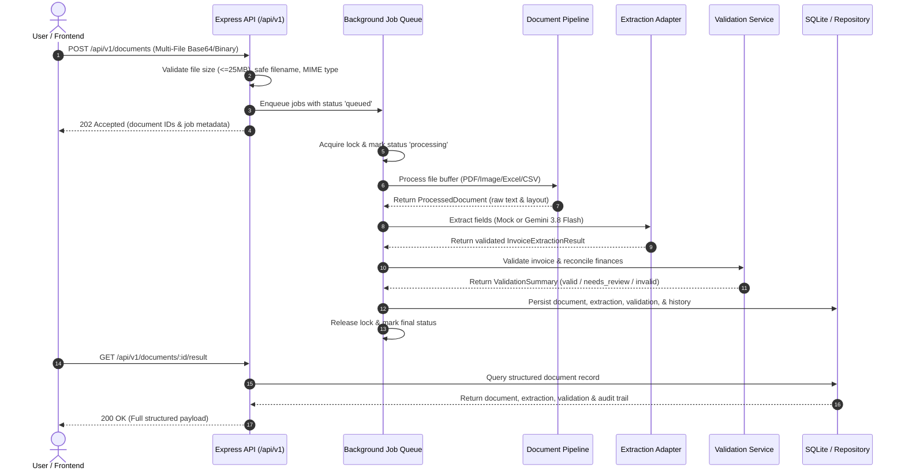
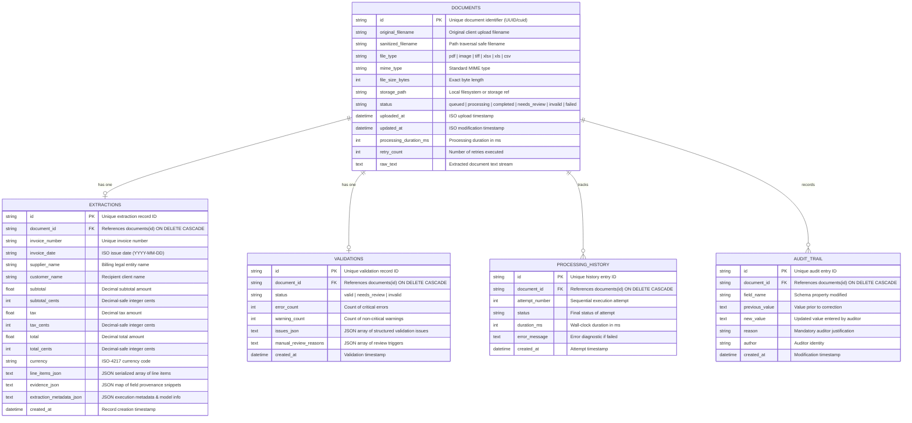

# DocuPulse — Architecture & Database Schema Specification

This document details the high-level architecture, module design, pipeline lifecycle, data models, and database schema for **DocuPulse — AI-Powered Document Intelligence System**.

---

## 1. High-Level System Architecture

DocuPulse is structured as an integrated multi-tier system combining multi-format ingestion, multimodal AI extraction, mathematical validation, asynchronous job orchestration, persistent relational storage, and an interactive React dashboard.

### System Architecture Diagram

```
+---------------------------------------------------------------------------------------------------------+
|                                        DOCUPULSE PRESENTATION LAYER                                     |
|  +---------------------------------------------------------------------------------------------------+  |
|  |                            React 19 + Tailwind CSS Single-Page Application                         |  |
|  |  [Multi-File Dropzone]   [Queue Health Banner]   [Document Table & Filters]   [Detail & Audit Modal] |  |
|  +---------------------------------------------------------------------------------------------------+  |
+---------------------------------------------------|-----------------------------------------------------+
                                                    | HTTP REST / JSON (Express Port 3000)
                                                    v
+---------------------------------------------------------------------------------------------------------+
|                                         DOCUPULSE BACKEND API SERVICE                                   |
|  +---------------------------------------------------------------------------------------------------+  |
|  |  Express Router (/api/v1)                                                                         |  |
|  |  - POST /documents (Upload)              - GET /documents/:id (Status)                            |  |
|  |  - GET  /documents/:id/result (Result)   - GET /documents (Paginated List & Search)               |  |
|  |  - PATCH/documents/:id/corrections       - POST/documents/:id/retry (Lock Protected)              |  |
|  |  - GET  /health (Queue Metrics)          - GET /openapi.json (OpenAPI 3.0 Specs)                  |  |
|  +---------------------------------------------------------------------------------------------------+  |
|                                                   |                                                     |
|                                                   v                                                     |
|  +---------------------------------------------------------------------------------------------------+  |
|  |  Asynchronous In-Memory Job Queue & Concurrency Lock Manager                                      |  |
|  |  - Lifecycle States: [queued] -> [processing] -> [completed / needs_review / invalid / failed]     |  |
|  +---------------------------------------------------------------------------------------------------+  |
+---------------------------------------------------|-----------------------------------------------------+
                                                    |
                                                    v
+---------------------------------------------------------------------------------------------------------+
|                                    PROCESSING & REASONING PIPELINE                                      |
|                                                                                                         |
|  1. Document Ingestion & Modular Parsers (src/services/document/)                                      |
|     +-------------+ +-------------+ +-------------+ +-------------+ +-------------+ +-------------+      |
|     | Digital PDF | | Scanned PDF | | JPG/PNG/TIF | | Modern XLSX | | Legacy XLS  | | Delimited   |      |
|     | (Layout Tx) | | (OCR Stream)| | (Dimensions)| | (OpenXML)   | | (BIFF8)     | | (RFC-4180)  |      |
|     +-------------+ +-------------+ +-------------+ +-------------+ +-------------+ +-------------+      |
|                                                   |                                                     |
|                                                   v (Standardized Clean Text Streams)                   |
|  2. AI Information Extraction (src/services/extraction/)                                                |
|     +---------------------------------------------------------------------------------------+           |
|     | ExtractionFactory                                                                     |           |
|     | +-----------------------------------------+ +---------------------------------------+ |           |
|     | | MockRuleBasedAdapter (Deterministic/CI) | | GeminiExtractionAdapter (Vision/LLM)  | |           |
|     | +-----------------------------------------+ +---------------------------------------+ |           |
|     | Grounded Output Schema: invoice_number, date, supplier, customer, subtotal, tax,      |           |
|     | total, currency, line_items, confidence, verbatim provenance evidence quotes          |           |
|     +---------------------------------------------------------------------------------------+           |
|                                                   |                                                     |
|                                                   v (Structured Invoice Result)                         |
|  3. Data Validation & Reconciliation (src/services/validation/)                                         |
|     +---------------------------------------------------------------------------------------+           |
|     | ValidationService                                                                     |           |
|     | - Decimal-Safe Integer Cents Financial Arithmetic (toCents / fromCents)               |           |
|     | - Line Items Sum vs Subtotal Check                                                    |           |
|     | - Subtotal + Tax vs Stated Total Check (Configurable Rounding Tolerance: $0.05)       |           |
|     | - Duplicate Invoice Candidate Detection (Supplier Name + Invoice Number Collision)   |           |
|     | - Calendar Date Validity & Future Date Threshold Audit                                |           |
|     | - Stable Status Verdict: [valid] | [needs_review] | [invalid]                         |           |
|     +---------------------------------------------------------------------------------------+           |
+---------------------------------------------------|-----------------------------------------------------+
                                                    |
                                                    v
+---------------------------------------------------------------------------------------------------------+
|                                   PERSISTENCE & SEARCH STORAGE LAYER                                    |
|                                                                                                         |
|  Active Engine: SQLite (better-sqlite3, WAL mode) | Migration Strategy: SQLAlchemy & PostgreSQL path    |
|  +--------------------+ +--------------------+ +--------------------+ +--------------------+            |
|  | documents          | | extractions        | | validations        | | processing_history |            |
|  | - id (PK)          | | - id (PK)          | | - id (PK)          | | - id (PK)          |            |
|  | - filenames        | | - doc_id (FK)      | | - doc_id (FK)      | | - doc_id (FK)      |            |
|  | - status, mime     | | - supplier, inv_no | | - status           | | - attempt_number   |            |
|  | - raw_text         | | - amounts (cents)  | | - issues_json      | | - duration_ms      |            |
|  | - uploaded_at      | | - line_items_json  | | - review_reasons   | | - error_message    |            |
|  +--------------------+ +--------------------+ +--------------------+ +--------------------+            |
|                                          +--------------------+                                         |
|                                          | audit_trail        |                                         |
|                                          | - id (PK)          |                                         |
|                                          | - doc_id (FK)      |                                         |
|                                          | - field, old/new   |                                         |
|                                          | - author, reason   |                                         |
|                                          +--------------------+                                         |
+---------------------------------------------------------------------------------------------------------+
```

---

## 2. Pipeline Ingestion & Extraction Flow



---

## 3. Database Schema & Tables

DocuPulse provides a dual ORM schema:
1. **Active TypeScript Schema (`src/db/`):** Backed by `better-sqlite3` with Write-Ahead Logging (`WAL`), composite indexes, foreign key enforcement, and idempotent versioned migrations.
2. **Python SQLAlchemy Models (`database/models.py`):** Fully documented declarative models ensuring zero code rewrites when connecting to an external PostgreSQL cluster via `DATABASE_URL`.

### Entity Relationship Diagram (ERD)



---

## 4. Indexing & Query Optimization Strategy

To support high-throughput filtering, rapid keyword searches, and instant duplicate candidate detection, the following composite indexes are applied:

| Table | Index Name | Indexed Columns | Query Purpose |
| :--- | :--- | :--- | :--- |
| `documents` | `idx_documents_status` | `(status)` | Status tab filtering (`queued`, `processing`, `needs_review`, etc.) |
| `documents` | `idx_documents_uploaded_at` | `(uploaded_at DESC)` | Default chronological document list sorting |
| `documents` | `idx_documents_file_type` | `(file_type)` | File format filtering (`pdf`, `xlsx`, `csv`) |
| `extractions` | `idx_extractions_supp_inv` | `(supplier_name, invoice_number)` | **O(1) duplicate collision candidate detection** |
| `extractions` | `idx_extractions_doc_id` | `(document_id)` | Foreign key relational joins |
| `extractions` | `idx_extractions_total_cents` | `(total_cents)` | Monetary range query filtering (`minTotal`, `maxTotal`) |
| `validations` | `idx_validations_doc_id` | `(document_id)` | Foreign key relational joins |
| `validations` | `idx_validations_status` | `(status)` | Review queue triage queries |
| `processing_history` | `idx_history_doc_id` | `(document_id)` | Document execution lifecycle history lookup |
| `audit_trail` | `idx_audit_trail_doc_id` | `(document_id)` | Chronological audit trail lookup |

---

## 5. Decimal-Safe Financial Representation

Floating-point representations (e.g. standard IEEE-754 numbers) suffer from binary representation drift ($0.10 + 0.20 = 0.30000000000000004$). In financial accounting, this causes false-positive reconciliation errors.

DocuPulse solves this through **integer cents arithmetic**:
- **Storage:** Database columns `subtotal_cents`, `tax_cents`, and `total_cents` store amounts as 64-bit integers ($1,250.50 \rightarrow 125050$).
- **Conversion Utility (`decimalUtils.ts`):**
  ```ts
  export function toCents(amount: number | null | undefined): number | null {
    if (amount === null || amount === undefined || isNaN(amount)) return null;
    return Math.round(amount * 100);
  }
  export function fromCents(cents: number | null | undefined): number | null {
    if (cents === null || cents === undefined) return null;
    return cents / 100;
  }
  ```
- **Reconciliation Rule:** Total equality check verifies:
  $$\left|(\text{subtotal\_cents} + \text{tax\_cents}) - \text{total\_cents}\right| \le (\text{roundingTolerance} \times 100)$$

---

## 6. Data Retention, Privacy & Sanitization

1. **Path Traversal Defense:** Filenames are stripped of path components (`../`, `..\`) and control characters via `sanitizeFilename()`, preventing filesystem overwrite attacks.
2. **Access-Controlled Text Retention:** Raw extracted text streams are stored exclusively in access-controlled database tables. Standard application logs suppress invoice bodies by default (`[REDACTED]`).
3. **Cascade Deletion:** Calling `documentRepository.delete(documentId)` invokes foreign key `ON DELETE CASCADE`, simultaneously removing extractions, validations, history logs, and audit entries.
4. **Synthetic Assessment Isolation:** All test fixtures and evaluation files utilize synthetic, fabricated company entities to ensure zero real PII or customer invoices are committed to the codebase.
